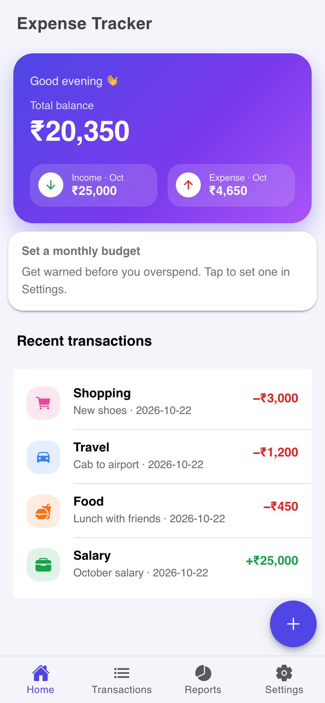
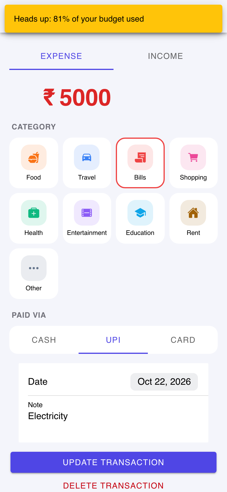
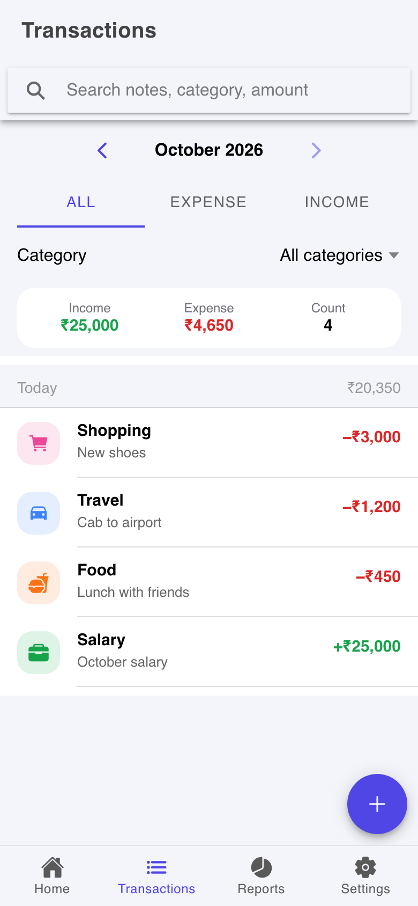
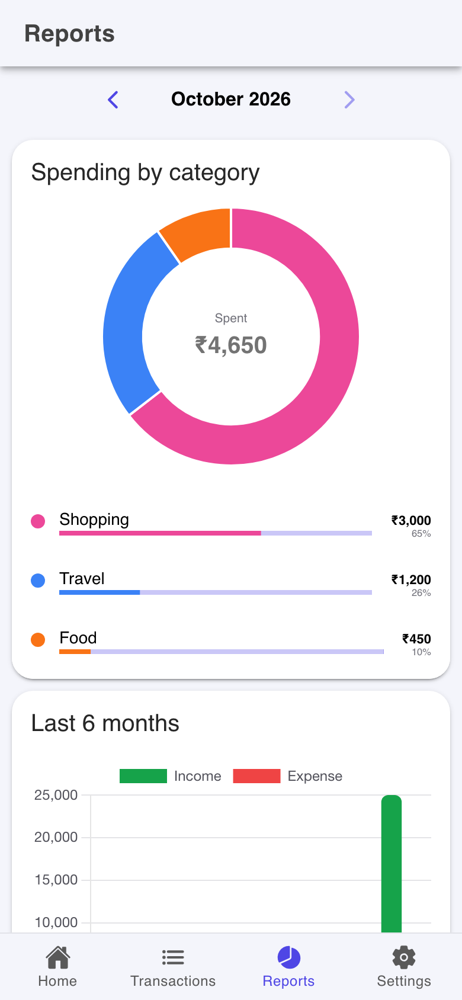
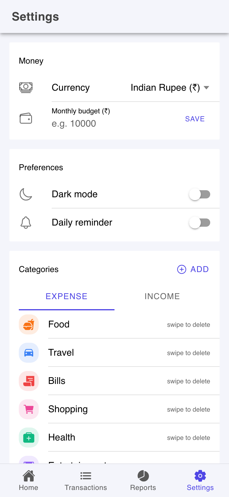
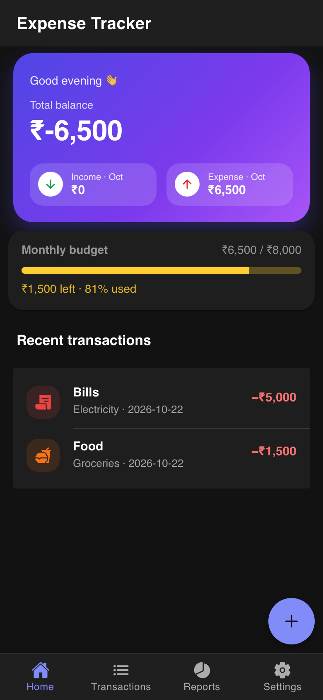

# Expense Tracker — Hybrid Mobile App

A personal finance app for logging income and expenses, setting a monthly budget and viewing spending reports.
It is built once as a **web application** (React + Ionic) and packaged as a native **Android app** with **Capacitor** (the hybrid approach).
All data is stored offline in a local **SQLite** database.

> **APK:** [`release/ExpenseTracker.apk`](release/ExpenseTracker.apk)

| Dashboard | Add / edit | Transactions | Reports | Settings | Dark mode |
|---|---|---|---|---|---|
|  |  |  |  |  |  |

## Features

- **Transactions**: add, edit and delete income and expenses with amount, category, date, payment mode (Cash/UPI/Card) and a note
- **Dashboard**: total balance, this month's income and expense, budget progress and recent transactions
- **Transaction history**: grouped by day, with search, month switcher, type and category filters, swipe to delete with undo
- **Reports**: doughnut chart of spending by category and a bar chart of income vs. expense over the last 6 months
- **Monthly budget**: progress bar, plus alerts at 80% and 100% (toast, vibration and a notification)
- **Categories**: 13 built-in categories, and you can add your own with a custom icon and colour
- **Daily reminder**: a notification at a time you choose
- **Export to CSV**: shared through WhatsApp, Gmail, Drive and other apps
- **Dark mode**, currency selection (₹ $ € £), splash screen and app icon

## Hybrid architecture

```
┌──────────────────────────────────────────────┐
│  React + Ionic UI  (HTML / CSS / JavaScript) │  ← same code runs in the browser
├──────────────────────────────────────────────┤
│  Capacitor bridge  (JS ⇄ native Java/Kotlin) │
├──────────────────────────────────────────────┤
│  Android WebView + native plugins            │
│  SQLite · Notifications · Filesystem · Share │
│  Haptics · Status bar · Splash screen        │
└──────────────────────────────────────────────┘
```

| Native feature | Capacitor plugin | Used for |
|---|---|---|
| SQLite database | `@capacitor-community/sqlite` | Offline storage of transactions, categories and settings |
| Local notifications | `@capacitor/local-notifications` | Daily reminder, budget alerts |
| File system | `@capacitor/filesystem` | Writing the CSV export |
| Share sheet | `@capacitor/share` | Sending the CSV to other apps |
| Haptics | `@capacitor/haptics` | Vibration feedback on save, delete and warnings |
| Status bar | `@capacitor/status-bar` | Status bar colour that follows the theme |
| Splash screen | `@capacitor/splash-screen` | Branded launch screen |
| App | `@capacitor/app` | Android hardware back button |

In the browser, the same SQLite API runs on **sql.js (WebAssembly)** through `jeep-sqlite`, so the web version and the app share one data layer.

## Database schema

```sql
categories   (id, name, icon, color, type)
transactions (id, type, amount, category_id → categories.id, date, note, payment_mode, created_at)
settings     (key, value)
```

The reports are calculated in SQL using `GROUP BY` and `SUM(CASE …)` (see `src/services/db.js`).

## Tech stack

React 19 · Ionic React 9 · React Router 6 · Capacitor 8 · SQLite · Chart.js · Vite

## Project structure

```
src/
├── App.jsx                  Tabs + routing
├── context/DataContext.jsx  App state, loads from and writes to SQLite
├── services/
│   ├── db.js                SQLite connection, schema, queries
│   ├── native.js            Notifications, haptics, CSV export/share, status bar
│   └── utils.js             Formatting, dates, icons
├── components/              TransactionModal, TransactionItem, BudgetCard, …
├── pages/                   Dashboard, Transactions, Reports, Settings
└── theme/                   Colours (light/dark) and styles
android/                     Native Android project generated by Capacitor
```

## Run and build

**Requirements:** Node 20+, Android Studio (Android SDK), JDK 21

```bash
npm install
npm run dev          # web version at http://localhost:5173
npm run apk          # build web → sync to Android → release/ExpenseTracker.apk
npm run android      # open the project in Android Studio
```

When you build from Android Studio, set **Settings → Build Tools → Gradle → Gradle JDK** to a JDK 21.
